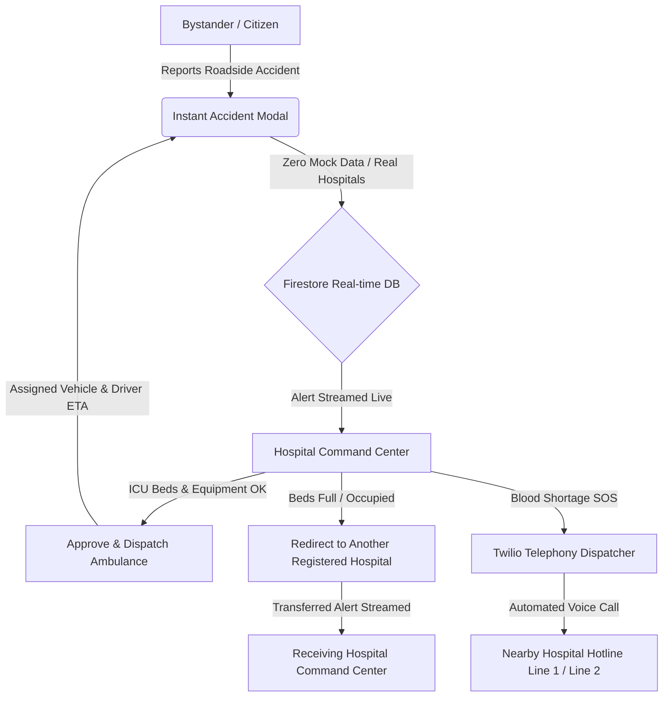

# 🩸 Aarogyam (आरोग्यम्)

> **"Connecting Care, Saving Lives."**  
> *A Next-Generation Real-Time Emergency Accident Triage, Ambulance Mobilization, Twilio Voice Telephony & Cryptographic Organ/Blood Allocation Network for Maharashtra.*

[](https://github.com/Manaspingle/Aarogyam_StrawHats.git)
[](https://vercel.com)
[](https://www.typescriptlang.org/)
[](https://react.dev/)
[](https://tailwindcss.com/)
[](https://firebase.google.com/)
[](https://www.twilio.com/)
[](https://opensource.org/licenses/MIT)

---

## 📌 Executive Overview

**Aarogyam** is an intelligent, mission-critical healthcare platform built to tackle India's **Golden Hour** emergency crisis. Operating across key medical hubs in Maharashtra (**Mumbai, Pune, and Nagpur**), the platform establishes an instantaneous digital bridge connecting roadside bystanders, trauma casualties, hospital casualty bays, ambulance drivers, and ethical organ/blood distribution networks.

Built with real-time Firestore database synchronization, trilingual accessibility (**English, हिन्दी, मराठी**), automated **Twilio voice telephony hotlines**, and an immutable **SHA-256 transparency ledger**, Aarogyam eliminates delays, prevents queue-jumping, and mobilizes emergency care within minutes.

---

## 🚀 Key Modules & Capabilities

### 1. 🚨 Instant Accident & Trauma Triage (Bystander 24x7)
- **Zero-Login Emergency Reporting**: Any bystander or Good Samaritan can report a roadside accident immediately from the landing page without registration.
- **City Selector**: Choose from major Maharashtra cities (Mumbai, Nagpur, Pune, Nashik, etc.) with real-time counts of active registered trauma centers.
- **Nearby Hospital Selector (Zero Mock Data)**:
  - Dynamically fetches and displays **real, registered platform hospitals** from Cloud Firestore.
  - Shows casualty address, 24x7 emergency helpline, and active trauma status.
- **Victim Count & Incident Landmarks**:
  - Interactive victim pills (`1`, `2`, `3`, `4`, `5+`).
  - Precise landmark input (`e.g. Near Toll Plaza / Metro Pillar 42`).
  - Required bystander callback number with Good Samaritan legal protection.
  - Patient condition and notes (`e.g. Bleeding from limb, conscious, needs stretcher`).
- **Live Bystander Tracking Screen**:
  - Automatically polls hospital action every 2.5 seconds.
  - Displays dynamic state progression:
    - ⏳ *Awaiting Hospital Bed & ICU Review*
    - 🚑 *Ambulance Dispatched!* (Displays vehicle registration, paramedic pilot name, driver phone with direct tap-to-call, and live ETA).
    - ⚠️ *Redirected Notice* (If the initial hospital's trauma beds are full, displays the new hospital and clinical reason).
    - 🏥 *Admitted & Stabilized*

---

### 2. 🏥 Hospital Command Center & Ambulance Dispatch Trigger
- **Live Casualty Stream**: Incoming accident reports targeted to the hospital automatically appear in real time without refreshing.
- **Trauma Bay Readiness Checklist**: Casualty staff verify available ICU beds, surgical accessories, and oxygen reserves.
- **One-Click Ambulance Dispatch**:
  - Approving a report automatically assigns an on-duty trauma ambulance (`MH-XX-AMB-XXXX`), paramedic driver, and dynamic ETA (~6–10 mins).
  - Updates incident status to `accepted` and alerts the bystander instantly.
- **Hospital-to-Hospital Redirection Protocol**:
  - If ICU/trauma beds are full, staff can click **"Redirect (Beds Full)"**.
  - Choose another registered hospital in the network with clinical reason codes (*Trauma ICU Full*, *OT Occupied*, *Specialized Neurotrauma Required*).
  - Transferred alerts immediately route to the receiving hospital's triage bay.
- **Patient Arrival & Admission**:
  - Mark active dispatched ambulances as safely admitted into trauma care once arrived.

---

### 3. 📞 Twilio Voice Telephony SOS Hotline Network
- **Hospital Emergency Broadcast**: When hospital blood banks or critical units run low, administrators can broadcast an emergency SOS.
- **Automated Voice Phone Calls**: Twilio Voice AI triggers simultaneous automated phone calls to local connected hospital casualty desks.
- **Dedicated Telephony Channels**:
  - **Hotline Line 1**: `+17372508034` (From) ➔ `+919067375860` (To)
  - **Hotline Line 2**: `+17372324091` (From) ➔ `+917387880399` (To)
  - **Hotline Line 3**: Reserved and future-ready.
- **TwiML Voice Engine**: Repeats urgent clinical details twice using Indian-accented English text-to-speech (`en-IN`), detailing units needed, blood group, urgency, and requesting facility.

---

### 4. 🌐 100% Trilingual Accessibility (English, हिन्दी, मराठी)
- **Universal Translation**: Full, seamless localization across all landing pages, hospital portals, donor portals, certificates, and emergency modals.
- **Devanagari Typographic Optimization**: Tailored line heights and tracking prevent vowel diacritic (matra) clipping across mobile and desktop viewports.
- **Instant Language Switcher**: Centrally available in both the top navigation bar and hero announcement header.

---

### 5. 🫀 Posthumous Organ Pledge & Digital Life Card
- **Legally Recognized Digital Consent**: Citizens can legally pledge vital organs (Kidneys, Liver, Heart, Lungs, Pancreas, Corneas) under the Transplantation of Human Organs Act (THOA).
- **Downloadable Organ Donor Card**: Instant card generation with unique Donor ID, emergency contacts, pledged organs, and verifiable QR code for rapid on-site verification.

---

### 6. 🎖️ Donor Rewards, Milestones & Verified Certificates
- **Milestone Honors**: Tiered recognition for verified blood donations:
  - 🥉 *Bronze Lifesaver* (1st donation · 30 LifePoints)
  - 🥈 *Silver Guardian* (3 donations · 100 LifePoints)
  - 🥇 *Gold Champion* (5 donations · 250 LifePoints)
  - 💎 *Platinum Hero* (10+ donations · 600 LifePoints)
- **Official State Certificates**: Verifiable digital donation certificates complete with Maharashtra state health emblem and cryptographic reference numbers.

---

### 7. 🔒 Cryptographic Transparency Ledger
- **SHA-256 Hashed Audit Trail**: Every blood transfer, match, and bed allocation generates an immutable cryptographic hash (`sha256(request_id + donor_id + timestamp + salt)`).
- **Zero Favoritism & Public Verifiability**: Protects ethical allocation and eliminates VIP queue-jumping or black-market organ trading.

---

## 🛠️ Architecture & Technology Stack



| Layer | Technologies |
| :--- | :--- |
| **Frontend Framework** | [React 18](https://react.dev/) + [Vite 7](https://vitejs.dev/) |
| **Programming Language** | [TypeScript 5.5](https://www.typescriptlang.org/) (Strict type checking, 0 errors) |
| **Styling & Design System** | [Tailwind CSS 3.4](https://tailwindcss.com/) + [Framer Motion 11](https://www.framer.com/motion/) |
| **Icons & Visuals** | [Lucide React](https://lucide.dev/) |
| **Routing** | [React Router DOM v7](https://reactrouter.com/) |
| **Database & Auth** | [Firebase 11](https://firebase.google.com/) (Cloud Firestore & Authentication) |
| **Telephony & Hotlines** | [Twilio REST API](https://www.twilio.com/) + Custom TwiML Audio Engine |
| **Cryptography** | Native Web Crypto API (SHA-256) |
| **Deployment** | [Vercel](https://vercel.com/) (Single Page Application configured via `vercel.json`) |

---

## 📁 Repository Structure

```
Aarogyam/
├── public/                         # Static assets (emblem, logos, favicon)
├── src/
│   ├── components/                 # Reusable UI & Modal components
│   │   ├── EmergencyAccidentModal.tsx  # Accident triage, real hospital selector & live tracking
│   │   ├── Navbar.tsx              # Responsive navigation & language toggle
│   │   ├── DashboardLayout.tsx     # Role-based dashboard shell & sidebar
│   │   ├── AmbulanceDirectory.tsx  # Ambulance fleet directory
│   │   └── ui/                     # Buttons, cards, badges, modal primitives
│   ├── context/                    # React Context providers
│   │   ├── AuthContext.tsx         # Hospital, donor, and admin session management
│   │   ├── LanguageContext.tsx     # Complete English, Hindi, and Marathi translations
│   │   └── ThemeContext.tsx        # Persistent dark & light theme management
│   ├── lib/                        # Core utilities & API integrations
│   │   ├── firebase.ts             # Firebase client initialization
│   │   ├── firebaseDb.ts           # Firestore CRUD, live listeners & ambulance triggers
│   │   ├── twilioService.ts        # Twilio telephony hotline calling engine
│   │   ├── compatibility.ts        # Medical matching & Haversine distance calculations
│   │   └── certificateLogo.ts      # State health emblem data URI
│   ├── pages/                      # Application views
│   │   ├── LandingPage.tsx         # Main landing page with hero, statistics & triage trigger
│   │   ├── HospitalDashboard.tsx   # Casualty command center, trauma triage & Twilio SOS
│   │   ├── DonorDashboard.tsx      # Donor milestone progression & appointment scheduler
│   │   ├── OrganPledge.tsx         # Legal posthumous organ pledge registry & donor card
│   │   ├── NearbyHospitals.tsx     # Radar map & inter-hospital blood transfers
│   │   ├── AuthPage.tsx            # Hospital & donor registration / login
│   │   ├── CreateRequest.tsx       # Blood demand request generator
│   │   └── TransparencyLog.tsx     # Public cryptographic audit ledger
│   ├── types/                      # Central TypeScript interfaces & data models
│   ├── App.tsx                     # Route hierarchy
│   ├── main.tsx                    # React DOM root entry point
│   └── index.css                   # Tailwind styles & typography tokens
├── vercel.json                     # Vercel SPA routing rewrite rules
├── package.json                    # Project metadata & dependencies
└── tsconfig.json                   # Strict TypeScript configuration
```

---

## 🚦 Getting Started Locally

### Prerequisites
- [Node.js](https://nodejs.org/) (v18.0.0 or higher)
- [npm](https://www.npmjs.com/) or [pnpm](https://pnpm.io/)

### Installation Steps

1. **Clone the repository:**
   ```bash
   git clone https://github.com/Manaspingle/Aarogyam_StrawHats.git
   cd Aarogyam_StrawHats
   ```

2. **Install project dependencies:**
   ```bash
   npm install
   ```

3. **Configure Environment Variables:**
   Create a `.env` file in the root directory (refer to `.env.example`):
   ```env
   VITE_FIREBASE_API_KEY=your_firebase_api_key
   VITE_FIREBASE_AUTH_DOMAIN=your_project.firebaseapp.com
   VITE_FIREBASE_PROJECT_ID=your_project_id
   VITE_FIREBASE_STORAGE_BUCKET=your_project.firebasestorage.app
   VITE_FIREBASE_MESSAGING_SENDER_ID=your_messaging_sender_id
   VITE_FIREBASE_APP_ID=your_app_id
   ```

4. **Launch the development server:**
   ```bash
   npm run dev
   ```
   Open [http://localhost:5173](http://localhost:5173) in your browser.

5. **Build for production:**
   ```bash
   npm run build
   ```

---

## ☁️ Deployment on Vercel

The project includes [`vercel.json`](./vercel.json) pre-configured with SPA route rewriting rules to prevent 404 errors on deep linking:

```json
{
  "rewrites": [
    {
      "source": "/(.*)",
      "destination": "/index.html"
    }
  ]
}
```

### Steps to Deploy:
1. Push your changes to the `main` branch of `Aarogyam_StrawHats`.
2. Connect the repository in [Vercel Dashboard](https://vercel.com).
3. Set Framework Preset to **Vite** (`Build Command: npm run build`, `Output Directory: dist`).
4. Add your Firebase environment variables in the Vercel project settings.
5. Click **Deploy**.

---

## 👥 Real Platform Hospital Accounts

Aarogyam uses **100% real registered platform hospitals** in Cloud Firestore:

| Hospital Facility | City | Trauma Capability | Registered Line |
| :--- | :--- | :--- | :--- |
| **Leelavati Hospital** | Mumbai | Level 1 Trauma ICU | 24x7 Casualty Desk |
| **Manas Hospital** | Mumbai | Emergency Surgery & Bay | Active Trauma Unit |
| **Sahil Hospital** | Mumbai | Critical Care & Bay | Verified Emergency |
| **A Hospital** | Nagpur | Apex Trauma Unit | Active Casualty |
| **B Hospital** | Nagpur | Emergency Surgery Center | Verified Emergency |

---

## 📄 License & Attribution

Distributed under the **MIT License**. See `LICENSE` for more information.

Developed with ❤️ for Maharashtra healthcare by the **StrawHats** team.  
*Dedicated to connecting care, eliminating delays, and saving lives.*
